<p align="center">
  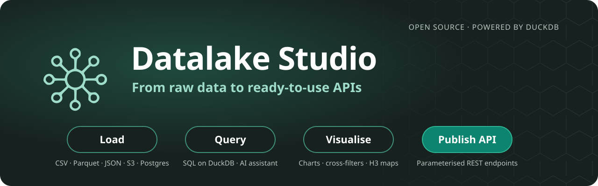
</p>

<p align="center">
  
  
  
  
  
  
  
</p>

# Datalake Studio

**From raw data to ready-to-use APIs.** Datalake Studio is an open-source data
workspace: load data from anywhere, explore millions of rows with DuckDB, query
with SQL or an AI assistant, visualise it on charts and maps, and publish any
query as a live REST API — all from a single tool that runs on your machine.

Built with **Vue 3** (frontend), **FastAPI** (backend) and **DuckDB** (engine).


## Table of contents

- [Key features](#key-features)
- [Quick start (Docker)](#quick-start-docker)
- [Running without Docker](#running-without-docker)
- [Configuration](#configuration)
- [Tests](#tests)
- [Usage](#usage)
- [License](#license)

## Key features

- **Fast on big data** — Built on top of [DuckDB](https://duckdb.org/), a
  high-performance embedded OLAP engine designed to handle large datasets, ideal
  for exploration and analysis.
- **Load from anywhere** — Upload from your computer, pull from a URL, browse an
  Amazon S3 bucket, or import directly from PostgreSQL databases.
- **Many formats** — CSV, TSV, Parquet, JSON and Shapefile, with no tedious
  conversions.
- **Visualise your data** — Automatic charts, interactive cross-filters, and
  geospatial maps with point and H3 hexagon aggregations.
- **AI SQL assistant** — With OpenAI credentials, describe what you need in plain
  language and get DuckDB SQL that already knows your tables and fields.
- **Enrich from remote APIs** — Augment your datasets by calling external APIs.
- **Publish as an API** — Turn any saved query into a parameterised REST endpoint
  and share live data with other applications.
- **Multi-user** — Optional login with username/password or "Sign in with
  Google", each user with their own workspace.

## Quick start (Docker)

The fastest way to run the whole stack (frontend + backend).

**Prerequisites:** Docker and Docker Compose. Ports **8080** and **8000** must be
free on your machine.

```bash
docker-compose up --build
```

Then open **http://localhost:8080/** in your browser. The backend API runs on
**http://localhost:8000/**.

Datalake Studio works out of the box for local files and URLs. To enable S3,
PostgreSQL, the AI assistant or maps, add a `server/secrets.yml` file (see
[Configuration](#configuration)). Docker Compose also mounts your `~/.aws`
credentials into the backend for AWS access.

The backend image already includes the DuckDB extensions it uses, so it starts
without downloading anything. It runs as a non-root user with uid 1000, which
should own `server/data`; if your uid is different, build with
`HOST_UID=$(id -u) docker-compose up --build`.

### Without Compose

Build and run each image separately:

```bash
# Backend
docker build -t datalakestudio-backend ./server
docker run --name datalakestudio-backend -p 8000:8000 datalakestudio-backend

# Frontend
docker build -t datalakestudio-frontend ./client
docker run --name datalakestudio-frontend -p 8080:8080 datalakestudio-frontend
```

## Running without Docker

### Server

From the `server/` folder:

```bash
uv venv venv                      # uses the Python version in .python-version (3.12)
source venv/bin/activate          # Windows: venv\Scripts\activate
uv pip install -r requirements.txt
python server.py
```

Requires **Python 3.11 or 3.12**: DuckDB 2.0 needs 3.11+, and the pinned pandas,
numpy and pyarrow have no wheels for newer versions. [uv](https://docs.astral.sh/uv/)
downloads that Python if your system doesn't have it, so the virtualenv keeps
working when the system Python is upgraded. With plain pip, create it with
`python3.12 -m venv venv`. Exit the virtualenv with `deactivate`.

### Client

From the `client/` folder:

```bash
npm install
npm run dev -- --port 8080
```

Then open **http://localhost:8080/**.

By default the client talks to the backend at `http://localhost:8000`. To point
it elsewhere, create a `client/.env` file:

```bash
VITE_API_URL=https://your-backend-host      # e.g. behind a reverse proxy
# or, individually:
# VITE_API_HOST=http://localhost
# VITE_API_PORT=8000
# VITE_GOOGLE_CLIENT_ID=your-google-client-id
```

## Configuration

### `server/config.yml`

Server behaviour. Example:

```yaml
port: 8000
databasesFolder: "data"          # where per-user databases are stored
defaultDatabase: "datalakeStudio.db"
downloadFolder: "temp"           # temp folder for uploads and exports
authEnabled: false               # true = require login; false = anonymous "default" user
allowedOrigins:                  # CORS origins for app endpoints (not /api/*)
  - "http://localhost:8080"
# sandboxEnabled: true           # confine each user's SQL (default: same as authEnabled)
# sandboxAllowedPrefixes:        # remote locations sandboxed SQL can reach
#   - "https://"
#   - "s3://"
# duckdbMemoryLimit: "4GB"       # per open database (default with authEnabled: 80% of RAM / duckdbMaxOpenDatabases)
# duckdbThreads: 4               # per open database (default: all cores)
# duckdbMaxOpenDatabases: 8      # beyond it, the least recently used database is closed
# duckdbIdleMinutes: 30          # close databases idle for longer than this
```

With the sandbox on, each user's SQL can only read and write their own database
folder, their upload folder and the allowed remote prefixes: other users' files,
the server's files and local paths elsewhere are refused, and the DuckDB settings
are locked. It is on by default when `authEnabled` is true; leave it off for a
single-user install where you want to query any local file.

### `server/secrets.yml`

Credentials and optional integrations. Copy the template and fill in what you
need — everything is optional depending on the features you use:

```bash
cp server/secrets.yml.template server/secrets.yml
```

It covers S3 access, OpenAI (AI assistant), the API search domain, the PostgreSQL
`pgpass` file, a Mapbox token (maps), Google OAuth and SMTP (email verification /
password recovery). If you enable `authEnabled`, also set a strong `jwt_secret`.

> **Never commit `secrets.yml` or `.pgpass`.** They are already in `.gitignore`,
> and a pre-commit hook in `.githooks/` blocks accidental secret commits — enable
> it with `git config core.hooksPath .githooks`.

### Remote databases (`.pgpass`)

To use remote PostgreSQL databases, point `pgpass_file` at a file with one line
per connection:

```
hostname:port:database:username:password
```

## Tests

```bash
# Backend (from server/, with the virtualenv active)
python -m pytest -q

# Frontend (from client/)
npm run test:run
```

## Usage

### Load data

Load from your local filesystem, any URL, S3, or a path on the server. Try this example dataset:
`https://raw.githubusercontent.com/javitorres/GenericCross/main/public/data/iris.csv`

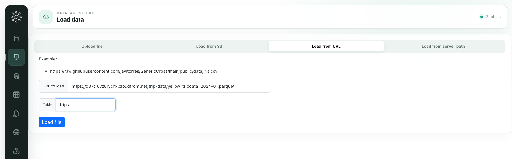

### Table explorer

Inspect loaded data and export it to CSV or Parquet.

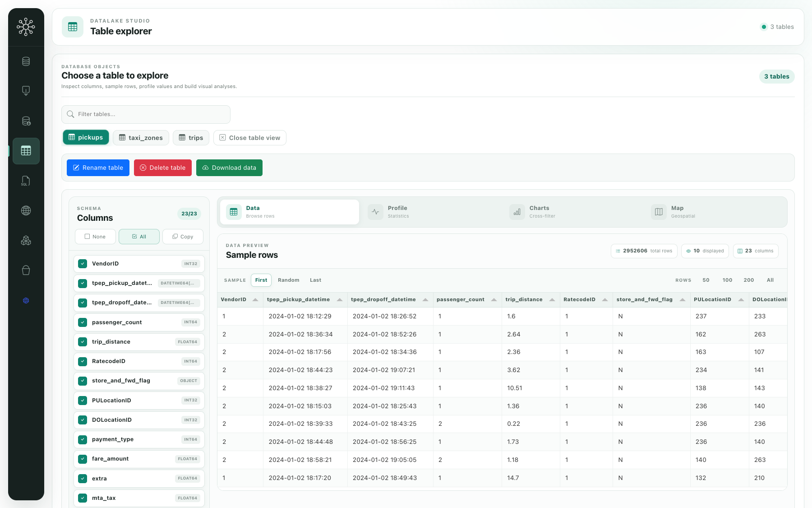

Get a data profile:

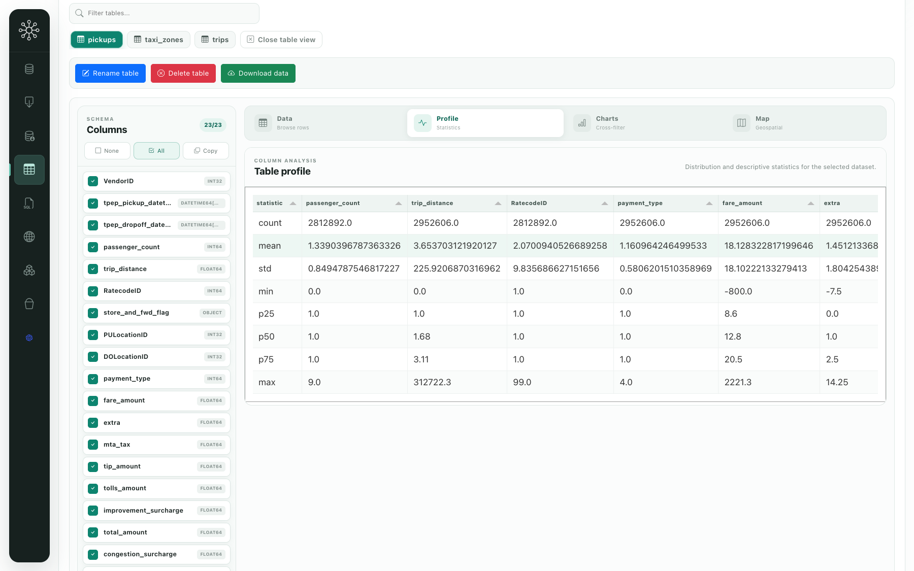

Or use cross-filters to explore interactively:

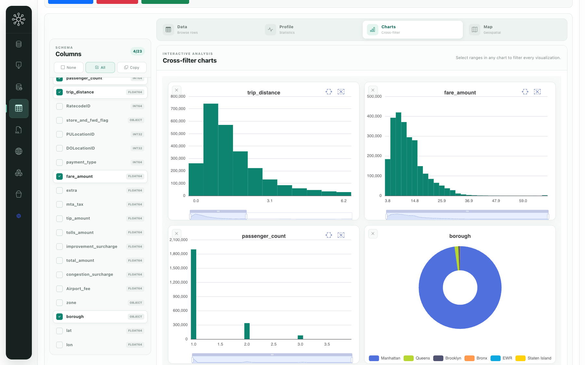

If your data has spatial information, view it on a map:

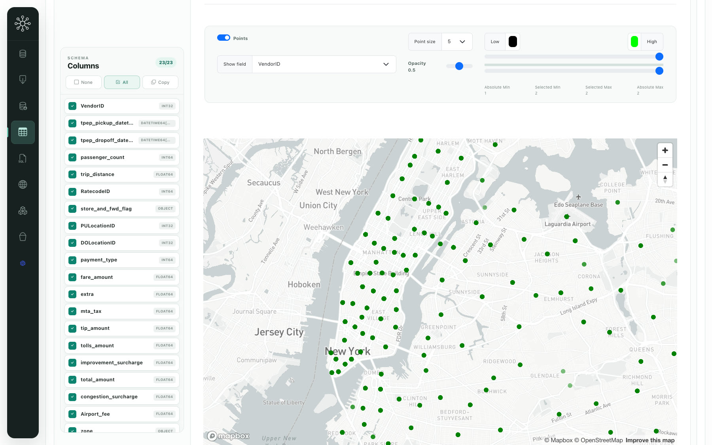

Or aggregate it into H3 hexagons, in 2D or 3D:

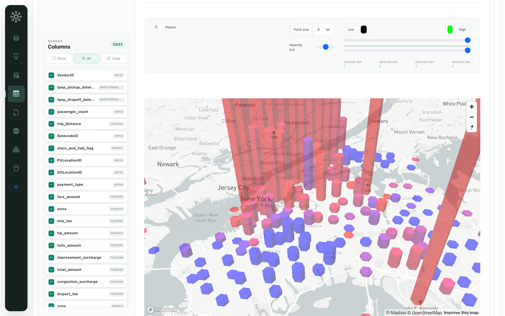

### Query panel

Query your data and generate new tables. Save and load queries, or ask the AI
assistant to write SQL for you.

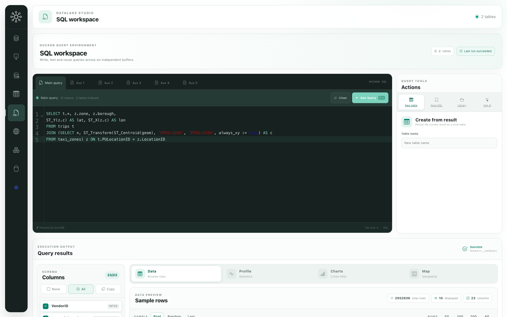

### Enrich from APIs

Enrich your datasets by calling external APIs. Pick a table, point to an endpoint
and check the response with the first row:

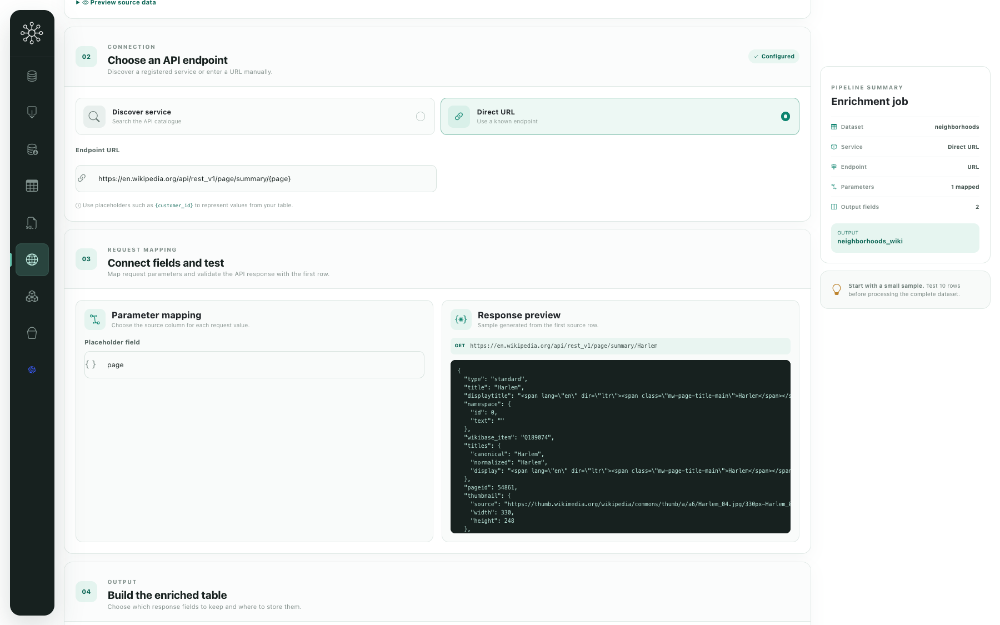

Then choose which response fields become new columns of the enriched table:

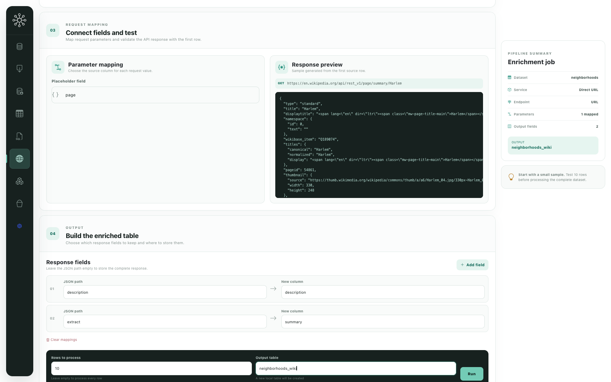

### Load from remote databases

Explore external databases and load data into Datalake Studio for local analysis:

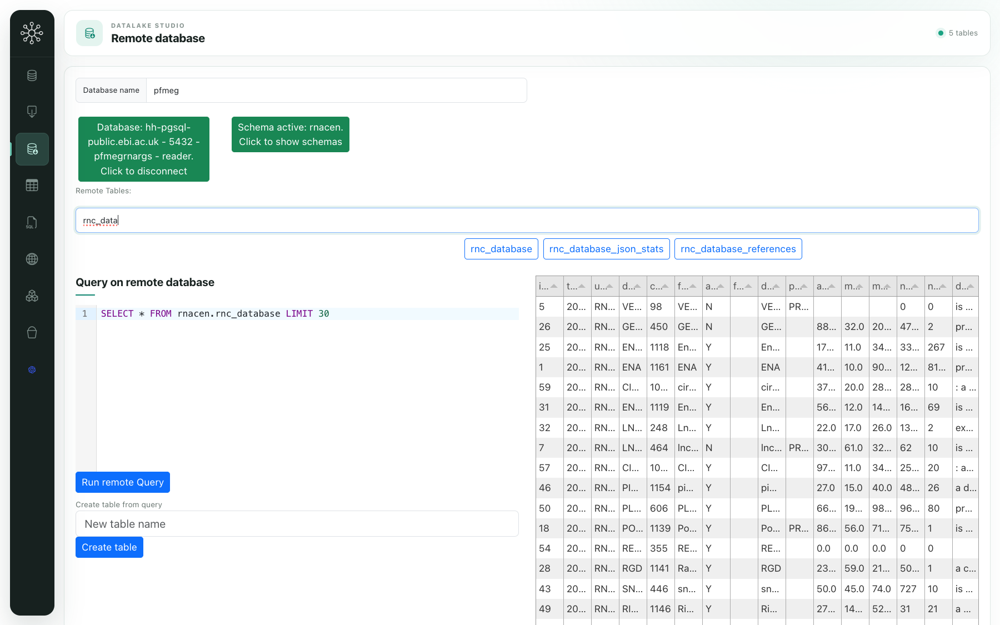

### Expose your data via API

Publish endpoints that serve your data with parameterised queries:

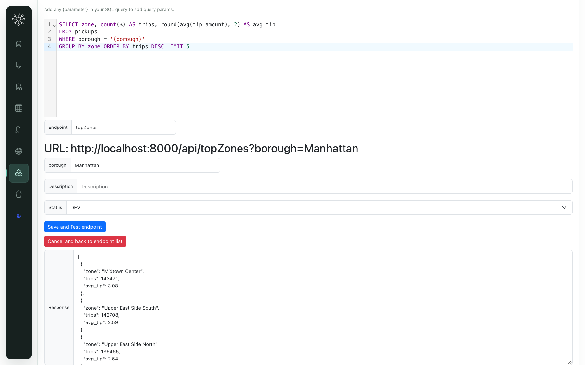

Keep control of the endpoints you publish:

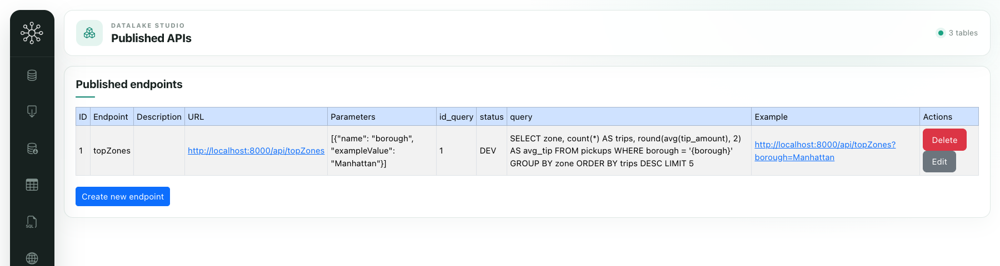

### Explore your S3 buckets

Navigate your S3 buckets and add descriptions:

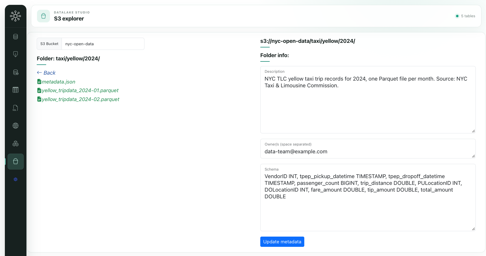

Preview files or load them into Datalake Studio:

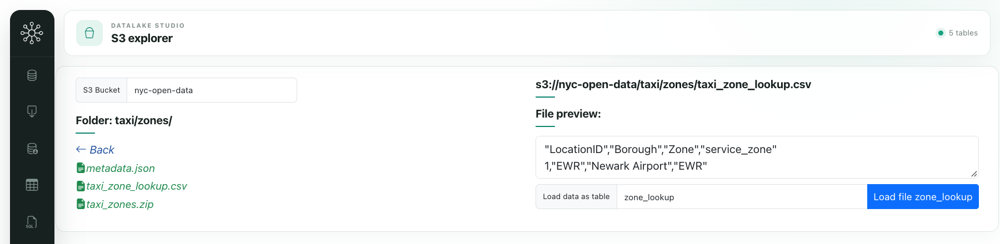

### Talk to ChatGPT

Explore your data conversationally (experimental):

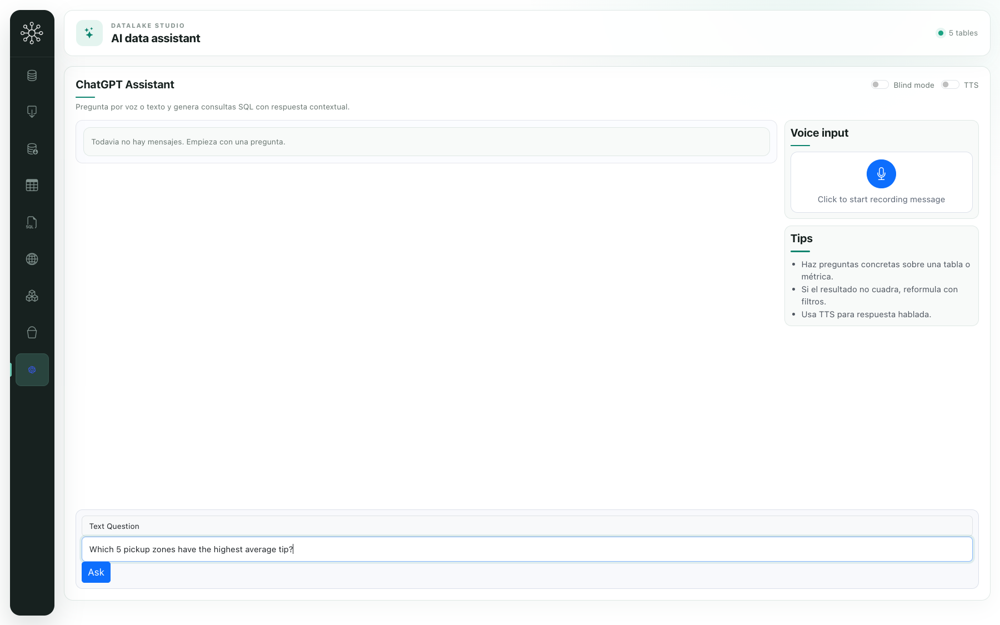

## License

Distributed under the **GNU General Public License v3.0**. See [LICENSE](LICENSE)
for details.
